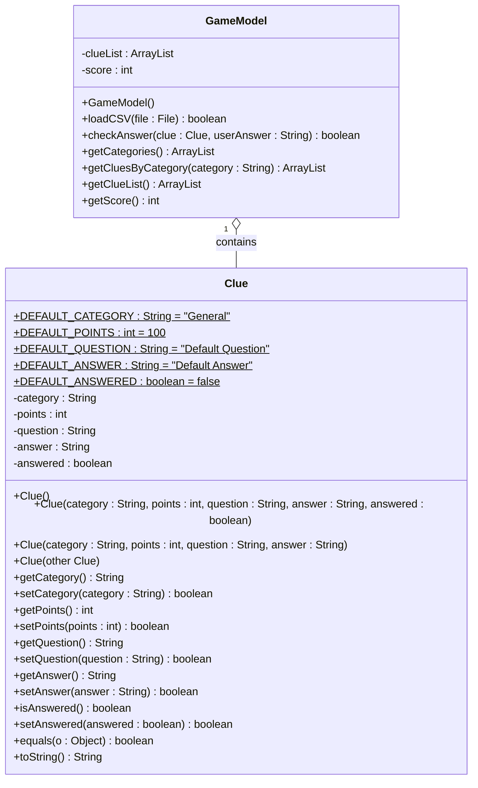
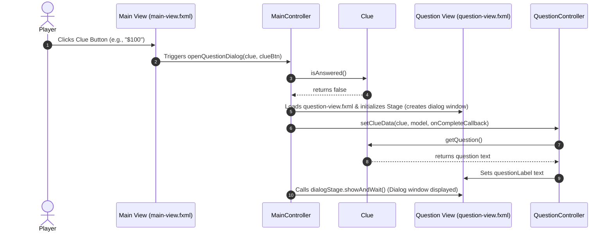
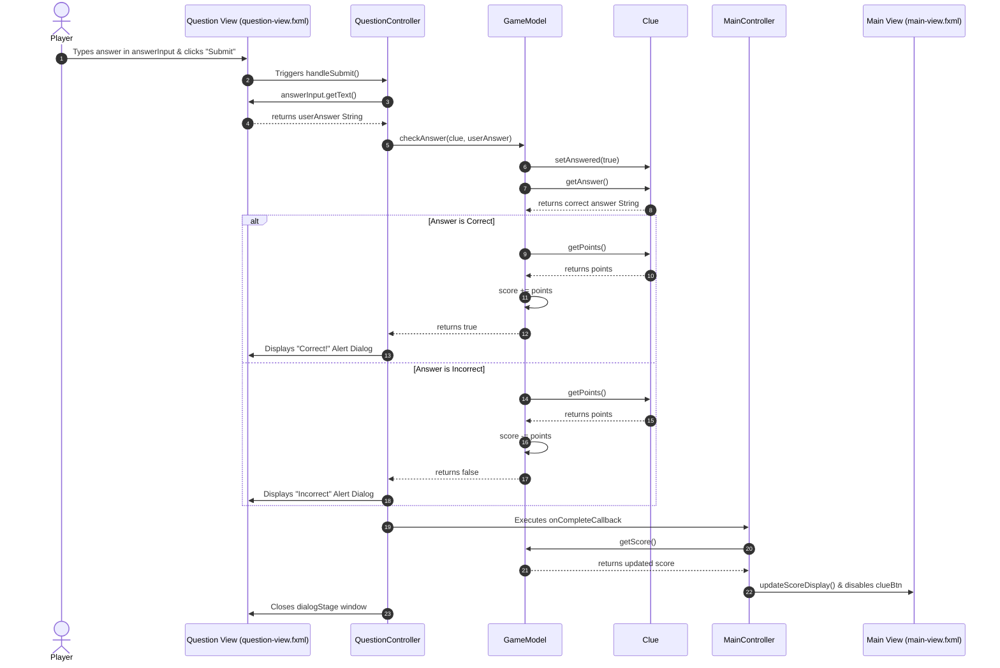

# CS112 JavaFX Jeopardy Game (MVC)

A desktop trivia game inspired by _Jeopardy!_, built with JavaFX following the Model-View-Controller (MVC) design pattern. The application dynamically loads trivia content from external CSV files, builds an interactive game board, processes answers, and tracks player scores.

> **NOTE:** Code and documentation were generated by Google Gemini, verified by faculty, and limited to concepts covered in _CS112 Intro to CS II: Java_ to use as a teaching tool and example of what student's can build by the end of the semester.

## Features

* **MVC Architecture:** Clean separation of concerns between Model (`GameModel`, `Clue`), View (`main-view.fxml`, `question-view.fxml`), and Controller (`MainController`, `QuestionController`).

* **Dynamic CSV Loading:** Load custom trivia datasets on the fly using JavaFX `FileChooser`.

* **Interactive Grid Board:** Dynamic column and row layout generation based on categories and point values in the loaded dataset.

* **Answer Validation:** Case-insensitive answer comparison with instant feedback and score updates.

* **Robust Model Layer:** Includes field validation, defensive copy constructors, constants for default values, and full Javadoc documentation.

## Requirements

* **Java Development Kit (JDK):** Version 17 or higher

* **Build Tool:** Apache Maven

* **IDE:** IntelliJ IDEA (or Eclipse / VS Code with JavaFX support)

## Project Structure

```
JavaFX_Jeopardy_MVC/
├── pom.xml                     # Maven dependencies and build configuration
├── jeopardy.csv                # Sample CSV trivia dataset
├── README.md                   # Project documentation
├── cs112-warmups               # CSV files related to CS112 topic warmups
└── src/
    └── main/
        ├── java/
        │   └── com/
        │       └── jeopardy/
        │           ├── JeopardyApp.java      # Main Application Entry Point
        │           ├── model/
        │           │   ├── Clue.java         # Data Model representing a single clue
        │           │   └── GameModel.java    # Core Business Logic & State
        │           └── controller/
        │               ├── MainController.java     # Controls Main Game Board UI
        │               └── QuestionController.java # Controls Question Popup Dialog
        └── resources/
            └── com/
                └── jeopardy/
                    └── fxml/
                        ├── main-view.fxml          # Main UI Layout
                        └── question-view.fxml      # Question Popup Layout
```

## System Architecture & Model Diagrams

### Class Diagram

Below is the UML class diagram illustrating the model layer structure, fields, methods, and relationship between `GameModel` and `Clue`:



### Clicking Clue Button Sequence Diagram

The sequence diagram below demonstrates the interaction between controller and model objects when selecting clue on the board:


### Answer Evaluation Sequence Diagram

The sequence diagram below demonstrates the interaction between controller and model objects when evaluating a player's answer:


## CSV File Format

The application expects a `.csv` file formatted with the following structure:

```csv
Category,Points,Question,Answer
Science,100,What planet is known as the Red Planet?,Mars
Science,200,What is the hardest natural substance on Earth?,Diamond
History,100,Who was the first President of the United States?,George Washington
History,200,In what year did World War II end?,1945
```

> **Note:** Fields with commas inside the text (e.g., questions with embedded commas) must be enclosed in double quotes.

## How to Build and Run

### Running in IntelliJ IDEA

1. Open IntelliJ IDEA and select **File > Open...**.
2. Select the `JavaFX_Jeopardy_MVC` root directory.
3. Allow Maven to import and resolve dependencies from `pom.xml`.
4. Navigate to `src/main/java/com/jeopardy/JeopardyApp.java`.
5. Right-click `JeopardyApp.java` and select **Run 'JeopardyApp.main()'**.
   - If `Error: JavaFX runtime components are missing, and are required to run this application` encountered, run `Launcher.java` main method instead

## How to Play

1. Click **Load CSV File** at the top right of the application window.
2. Select any compatible trivia CSV file (several topic warmups provided in `cs112-warmups` directory).
3. Click any point dollar button on the game board to reveal a question.
4. Type your answer in the modal input box and click **Submit Answer**.
5. Correct answers award points; incorrect answers deduct points.